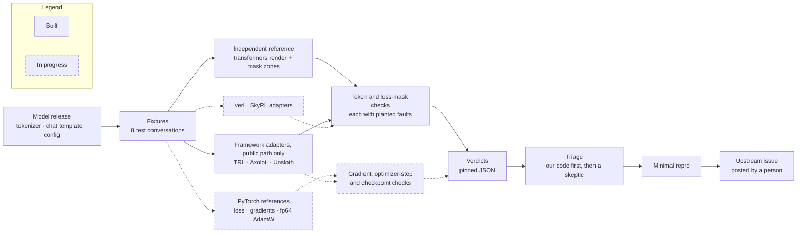
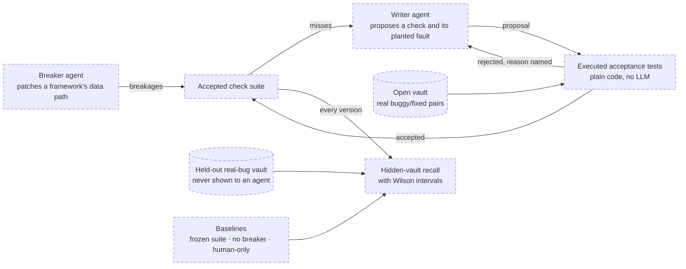

# Parity

Parity checks what LLM fine-tuning frameworks actually feed into training. It runs the same conversations through each framework's own public code path, then compares the token ids and the loss mask, token by token, with an independent reference built from the model's own chat template. A difference is triaged with our own code as the first suspect, and a real one becomes a minimal reproduction script and an issue a maintainer can run.

It currently covers TRL 1.18.2, Axolotl 0.21.1 and Unsloth 2026.11.10, calibrated on [`Qwen/Qwen3-0.6B@c1899de289a04d12100db370d81485cdf75e47ca`](https://huggingface.co/Qwen/Qwen3-0.6B).

## Differential testing harness

Silent training bugs don't crash. A framework that drops the loss on the end-of-turn token, renders the chat template slightly differently, or ignores a padding setting still trains, and the loss still goes down. Parity asks one question two ways, "which tokens does the model train on, and with which labels?": once through the framework's own preprocessing and collator, and once through an independent reference.



Solid boxes are built. Dashed boxes are in progress and not built yet.

- **The reference** renders each conversation through transformers (`apply_chat_template`): with the model's own chat template for template parity, and with the template the framework declares it uses for the other checks. It finds each assistant span by a prefix diff, cross-checked against the template's generation markers when it has them, and puts every token in one zone: must train, neutral, or must not train.
- **An adapter** builds the framework's trainer the way a user would and reads what it would train on: TRL's `SFTTrainer` with `assistant_only_loss`, Axolotl's `type: chat_template` preprocessing and collator, and Unsloth's Qwen3 notebook recipe with `train_on_responses_only`. It never reimplements the framework's tokenization, masking or collation, because then it would test our code instead of theirs.
- **A check** compares the two exactly, token by token. It passes only if, in the same run, it also caught every fault planted into the same adapter. A missed planted fault makes the verdict `inconclusive`, never `pass`.

### Built: token and loss-mask checks

The six checks run on eight fixtures (`single_turn`, `multi_turn`, `system_prompt`, `tool_call`, `reasoning`, `empty_assistant`, `long_answer`, `non_ascii`), in two serving modes: thinking, the model's default and the primary result, and non-thinking, a secondary result. Each check carries its own planted faults: 22 in all, of which 3 reproduce a bug someone actually hit (linked) and the rest are synthetic. The descriptions are as the calibration verdicts recorded them on Qwen/Qwen3-0.6B.

| Check | What it asks | Planted faults it must catch |
| --- | --- | --- |
| [`t1.template_parity`](src/parity/checks/tier1/template_parity.py) | Does the framework feed the model the tokens the model's own chat template defines? | `drop_newline`: drop the first newline token<br>`swap_stop_token`: replace the first `<\|im_end\|>` with `<\|endoftext\|>`<br>`rstrip_render`: strip trailing whitespace from the rendered text (drops the final separator) |
| [`t1.assistant_mask`](src/parity/checks/tier1/assistant_mask.py) | Under an assistant-only objective, is loss on exactly the assistant's own tokens? | `unmask_prompt`: give loss to everything before the first supervised token<br>`zero_mask`: no loss anywhere<br>`shift_labels_left`: labels shifted left by one<br>`late_start`: every supervised span starts one token late<br>`wrong_label_values`: supervised labels point at a different token; which tokens get loss is unchanged<br>`train_only_last_turn`: loss only on the last assistant turn<br>`span_starts_at_header`: each assistant span also trains its role header |
| [`t1.end_of_turn`](src/parity/checks/tier1/end_of_turn.py) | Does every assistant turn end with the model's stop token, trained? | `mask_closing_tokens`: take the loss off every supervised stop token ([real-world](https://arxiv.org/pdf/2611.13393))<br>`wrong_closing_token`: close every assistant turn with a different stop/special token, trained |
| [`t1.special_tokens`](src/parity/checks/tier1/special_tokens.py) | Are BOS, stop and pad tokens handled the way the template defines? | `extra_leading_special`: prepend `<\|endoftext\|>` to every row<br>`pad_is_closing_token_masked`: collator pads with `<\|im_end\|>` and takes the loss off every `<\|im_end\|>` ([real-world](https://github.com/huggingface/transformers/blob/v5.24.0/src/transformers/data/data_collator.py#L798-L800))<br>`pad_to_ignored`: the batch comes back padded only to its longest row: the requested width is dropped ([real-world](https://github.com/unslothai/unsloth-zoo/blob/cad81ef2dc557b1060896d3b294ef6b9a7f9c1ea/unsloth_zoo/dataset_utils.py#L2547-L2583))<br>`closing_token_masked_per_row`: pad id set to `<\|im_end\|>` and every `<\|im_end\|>` masked in each row before batching |
| [`t1.truncation`](src/parity/checks/tier1/truncation.py) | At the length limit, does the framework cut the way it says it does, and keep the loss right? | `off_by_one`: cut to max_len - 1 (right)<br>`lose_answer_labels`: keep the cut row but take the loss off everything<br>`reappend_stop`: put the stop token back as the last token, with loss |
| [`t1.multiturn_prefix`](src/parity/checks/tier1/multiturn_prefix.py) | Does the framework render earlier turns the same way once later turns follow? | `history_false_as_python`: re-render earlier tool-call arguments as a Python repr (false -> False)<br>`history_false_as_python_tokens`: in the encoded output, swap `false` tokens for `False` in assistant turns that are history<br>`history_edit`: re-render earlier assistant turns with one character changed |

Calibrated on TRL 1.18.2, Axolotl 0.21.1 and Unsloth 2026.11.10: 288 verdicts, and 658 of 658 planted-fault runs caught. Details are under [Reproducible experiments](#reproducible-experiments).

### In progress (dashed above)

- **verl and SkyRL adapters**, for the RL post-training stacks. Not written yet.
- **Gradient, optimizer-step and checkpoint checks**, on tiny random-weight models built from each release's config, against plain PyTorch references: the loss recomputed with cross-entropy over the same labels, gradient accumulation against one full batch, the AdamW step recomputed in fp64 (reporting the share of stuck weights), and save-and-resume against an uninterrupted run. They will fail when the relative error exceeds 4 times the measured noise floor ([design](docs/plan/02-detailed-blueprint.md)).

## Silent training bugs: candidate findings

Every fail is triaged before it is called anything. Our adapter, fixture and reference are ruled out first, and then a separate skeptic review tries to prove the fail is not a framework bug. A finding stays a candidate until a maintainer confirms it. Both tables are rendered from the [findings ledger](findings/LEDGER.md) and each finding's record.

| ID | Framework | What happens | Severity | Status | Upstream issue |
| --- | --- | --- | --- | --- | --- |
| [P-0002](findings/P-0002/record.md) | Axolotl 0.21.1 | An empty assistant turn's end token is never labeled, silently | low, on reach (only assistant turns that render empty) | candidate | [axolotl-ai-cloud/axolotl#4318](https://github.com/axolotl-ai-cloud/axolotl/issues/4318), posted 2026-11-26; maintainer replied (below) |
| [P-0004](findings/P-0004/record.md) | Unsloth 2026.11.10 (CPU backend) | On CPU, Unsloth's Qwen3 recipe trains on rows with a second `<\|im_end\|>`: stock TRL preparation appends it (TRL #3318 behavior); Unsloth's GPU-route preparation doesn't | low (CPU backend only) | candidate | none (card only) |
| [P-0005](findings/P-0005/record.md) | Unsloth 2026.11.10 | `train_on_responses_only` silently drops `SFTConfig.pad_to_multiple_of` (class: config value silently ignored) | low (an ignored setting; labels not affected) | candidate | [unslothai/unsloth#19567](https://github.com/unslothai/unsloth/issues/19567), posted 2026-11-25; no maintainer reply yet |
| [P-0007](findings/P-0007/record.md) | Axolotl 0.21.1 | DeepSeek V4.1: every message field but role and content is dropped before rendering (Axolotl's template analyzer sees none of this template's fields), so reasoning and tool calls vanish from the rows and `</think>` is never trained | medium (effect: reasoning traces and tool calls vanish from the training rows, so their tokens get no loss and the model never learns to close its reasoning with `</think>`; reach: every DeepSeek V4.1 conversation with reasoning or tool calls, which ordinary training data contains), by effect x reach (docs/DECISIONS.md) | candidate | none |
| [P-0008](findings/P-0008/record.md) | TRL 1.18.2 (vlm) | Inkling-2-Mini, vision path: an assistant turn with `content: ""` and tool calls or reasoning gains an empty text message (3 trained tokens) the template doesn't render; TRL's text path and `content: null` are unaffected | medium (effect: three extra tokens (an empty text message) are rendered and trained in each affected assistant turn, so the model learns to open an empty text message before its tool call or after its reasoning, which the model's own render never has; reach: assistant turns with tool calls or reasoning whose `content` is the empty string, a common convention in tool-calling and reasoning data, but not reached when `content` is `null`), by effect x reach (docs/DECISIONS.md) | candidate | none |

Severity is effect × reach, set before any target results existed ([decision log](docs/DECISIONS.md)). Medium means a change to labels, loss or stop behavior on inputs that ordinary training data contains: normal multi-turn chat, tool calls, reasoning traces, typical lengths. The same effect on rare inputs only is low, and so are ignored settings, performance-only effects and CPU-only behavior.

**Ruled out after triage.** These looked like framework problems and turned out not to be. They stay listed, because how a fail was ruled out is part of the evidence.

| ID | Framework | What we saw | Outcome | Counted against the framework? |
| --- | --- | --- | --- | --- |
| [P-0001](findings/P-0001/record.md) | Axolotl 0.21.1 | With Qwen3's own template in thinking mode, the think-block opener (`<think>` and blank lines) is untrained; reasoning text is trained | known difference (KD-0002, KD-0003) | No. Documented and tested behavior |
| [P-0003](findings/P-0003/record.md) | TRL 1.18.2 | Non-thinking cells judged rows that were never encoded in non-thinking mode | harness error (ours), H-9 | Never |
| [P-0006](findings/P-0006/record.md) | Unsloth 2026.11.10 (GPU) | Non-thinking mode: `train_on_responses_only` trains the last turn's empty think block, which the reference puts on the prompt side as a pre-fill | closed: not configurable | No. Its cells are not judged |

Our own mistakes are counted as well: **12 harness errors caught** so far, each an error in our reference, a check, the engine, an adapter or a test that produced, or could have produced, a wrong verdict ([ledger](findings/LEDGER.md#harness-errors-caught-12)). None of them counts against a framework.

### Upstream fixes

Merged fixes and fix commits, from each record's "Fixed in" lines.

None yet.

Reported upstream, awaiting a fix:

- [axolotl-ai-cloud/axolotl#4318](https://github.com/axolotl-ai-cloud/axolotl/issues/4318) ([P-0002](findings/P-0002/record.md), Axolotl 0.21.1), posted 2026-11-26
- [unslothai/unsloth#19567](https://github.com/unslothai/unsloth/issues/19567) ([P-0005](findings/P-0005/record.md), Unsloth 2026.11.10), posted 2026-11-25

### Maintainer acknowledgments

Maintainer replies, labels or fixes, quoted with a link, from each record's "Maintainer response" lines.

- [P-0002](findings/P-0002/record.md), [axolotl-ai-cloud/axolotl#4318 (comment)](https://github.com/axolotl-ai-cloud/axolotl/issues/4318#issuecomment-7184341120) (2026-11-26): "Thank you for the clear repro. That may have been an edge case, we haven't thought of intentionally empty assistant turn."

## Self-improving check loop (working towards)

Not built yet. This section is the plan and the way it will be judged, written down before any of it runs. It reports no results until they are measured.



Everything in this diagram is dashed: not built yet. Today's suite is the six hand-written checks above.

- **Writer agent.** Reads public issues, changelogs, chat-template diffs, the current suite and the breaker's misses. It proposes a new check together with its planted fault, tied to the bug it targets.
- **Breaker agent.** A separate agent that invents small patches to a framework's data path, each with the symptom it should cause. Every breakage the suite misses goes to the writer as a blind spot.
- **Checks gated by executed tests.** Plain code, not an LLM, decides what joins the suite, cheapest test first. A proposed check must raise no false alarm on any known-good setup (3 runs each), catch its own planted fault, catch its target (fail on the buggy version and pass on the fixed one, using a real pair from the open vault, or kill a breaker's breakage), and catch something the current suite misses, which keeps suite size honest.
- **Held-out real-bug vault.** Real silent training bugs, each stored as a buggy/fixed version pair and admitted only if both sides reproduce in all 5 of 5 runs. Part of the vault is held out by fix date, and one whole framework is held out for a transfer test. No agent ever sees the held-out split. Only the evaluation harness reads it, and it reports aggregates only.

**Evaluation.** Every suite version and every baseline is scored the same way:

- **Metric:** hidden-vault recall, the share of held-out pairs caught (the check fails on the buggy version and passes on the fixed one), with a 95% Wilson interval, per iteration over 10 iterations. Suites are compared at equal size, using random subsets of k checks, never by raw totals. A version with any false alarm on the calibration set doesn't count.
- **Compared against:** the frozen hand-written suite; the same loop with no breaker (the ablation); and human-only checks written over the same calendar window, with the hours reported.
- **Seeds:** 3 loop runs from the frozen suite with different seeds. The gain has to show up in every one.

```math
\text{Wilson 95\% interval:}\quad \frac{\hat p + \frac{z^2}{2n} \pm z\sqrt{\frac{\hat p(1-\hat p)}{n} + \frac{z^2}{4n^2}}}{1 + \frac{z^2}{n}},\qquad \hat p = \frac{\text{caught}}{n},\ z = 1.96
```

**The goal:** raise hidden real-bug recall with each iteration, and beat the human-only baseline at equal suite size, with intervals that don't overlap. If the loop can't beat the human-only baseline, the hand-written suite stays, and the negative result is published. Sources: the [overview](docs/plan/01-overview.md), the [evaluation protocol](docs/plan/02-detailed-blueprint.md), and the [decision log](docs/DECISIONS.md) for the number of iterations.

## Reproducible experiments

Everything here runs from a clone of this repository. You need Linux or WSL2 on x86_64, Python 3.12 and [uv](https://docs.astral.sh/uv/). The CPU runs need no GPU, no account and no token: only the tokenizer, chat template and config files of `Qwen/Qwen3-0.6B@c1899de289a04d12100db370d81485cdf75e47ca` are downloaded from the Hugging Face Hub, and any model is a tiny random-weight one built from that config.

```bash
uv sync
uv run pytest -q    # core tests; the framework adapter tests skip in this environment
```

### Calibration: TRL and Axolotl, locally on CPU

Calibration runs all six checks and every planted fault on Qwen/Qwen3-0.6B, on all eight fixtures, in both serving modes. Green means no untriaged fail, no inconclusive verdict caused by our harness, and every planted fault caught ([the rule, as code](src/parity/engine/calibration.py)). Fails linked to a known difference or to a triaged finding are allowed, and listed.

TRL 1.18.2, about 3 minutes on a laptop CPU:

```bash
(cd envs/trl-1.18.2 && uv sync)
envs/trl-1.18.2/.venv/bin/python docs/evidence/2026-11-25-m4-calibration/run.py trl
```

It ends with:

```text
thinking [(('fail', 'difference'), 4), (('not_applicable', None), 4), (('pass', None), 40)]
non_thinking [(('fail', 'difference'), 3), (('not_applicable', None), 10), (('pass', None), 35)]
fail verdicts: 7; root causes: {'KD-0001': 7}; untriaged 0
```

Axolotl 0.21.1, about 17 minutes:

```bash
(cd envs/axolotl-0.21.1 && uv sync)
envs/axolotl-0.21.1/.venv/bin/python docs/evidence/2026-11-25-m4-calibration/run.py axolotl
```

It ends with:

```text
thinking [(('fail', 'bug'), 4), (('fail', 'difference'), 13), (('not_applicable', None), 4), (('pass', None), 27)]
non_thinking [(('fail', 'bug'), 4), (('not_applicable', None), 10), (('pass', None), 34)]
fail verdicts: 21; root causes: {'P-0001': 13, 'P-0002': 8}; untriaged 0
```

Each run rewrites its framework's committed verdicts in place, so `git status` shows whether it reproduced them. Then write the report, in the core environment, in seconds:

```bash
uv run python docs/evidence/2026-11-25-m4-calibration/report.py
```

```text
trl@1.18.2: green; untriaged 0, harness inconclusive 0, plants missed 0
axolotl@0.21.1: green; untriaged 0, harness inconclusive 0, plants missed 0
unsloth@2026.11.10 (gpu): green; untriaged 0, harness inconclusive 0, plants missed 0
wrote runs/calibration-2026-11-25.md
```

The results, from the committed verdicts and the [report](runs/calibration-2026-11-25.md):

| Framework | Route | Verdicts | Pass | Fail, each linked to a known difference or a triaged finding | Not judged | Planted-fault runs caught | Green |
| --- | --- | --- | --- | --- | --- | --- | --- |
| [TRL 1.18.2](docs/evidence/2026-11-25-m4-calibration/trl) | CPU | 96 | 75 | 7 (KD-0001 ×7) | 14 not applicable | 262 of 262 | yes |
| [Axolotl 0.21.1](docs/evidence/2026-11-25-m4-calibration/axolotl) | CPU | 96 | 61 | 21 (P-0001 ×13, P-0002 ×8) | 14 not applicable | 256 of 256 | yes |
| [Unsloth 2026.11.10](docs/evidence/2026-11-25-m4-calibration/unsloth) | GPU (Tesla T4) | 96 | 36 | 8 (P-0005 ×8) | 8 not applicable, 44 not configurable | 140 of 140 | yes |

"Not applicable" cells are decided from the fixture alone, before any framework output exists: for example, the multi-turn prefix check needs two assistant turns, and a fixture whose assistant turn reasons has no non-thinking reading. "Not configurable" means the framework documents no way to train for that serving mode: Unsloth documents non-thinking training only through the `/no_think` soft switch.

### Unsloth on a GPU: the Colab kit

Unsloth's calibration runs on its GPU route, on a free Colab T4 GPU. A full run takes about 30 to 45 minutes, most of it installing; the checks themselves took 19 minutes on a T4.

1. Build the kit from a clean checkout. It packs `git archive` of HEAD and refuses uncommitted changes:
   ```bash
   uv run python docs/gpu-run/build_kit.py    # writes dist/gpu-kit/<commit>/
   ```
2. In Colab, upload the kit's `parity_gpu_run.ipynb`, choose a T4 GPU, and run the cells in order with `RUN = "full"`. Cell 4 uploads the kit's `parity-src-<commit>.zip`. Cell 5 ends with `DONE:` and the results zip's name, and cell 7 downloads `parity-gpu-results-<commit>-<time>.zip`. The notebook refuses to fall back to CPU.
3. Verify and merge the zip. This checks every file against the zip's manifest, rebuilds `git archive` of the recorded commit and compares its sha256, and checks that every verdict records Unsloth's GPU route and the run's lockfile:
   ```bash
   uv run python docs/evidence/2026-11-25-m4-calibration/report.py --unsloth-zip <path to the results zip>
   ```
   It prints `verified:` with the run's facts, then the status lines above.

Step-by-step instructions and troubleshooting: [the GPU run guide](docs/gpu-run/GPU-RUN.md).

### Evidence, pins and predictions

- **Calibration verdicts**, one JSON file per check, fixture and serving mode: [TRL](docs/evidence/2026-11-25-m4-calibration/trl/), [Axolotl](docs/evidence/2026-11-25-m4-calibration/axolotl/) and [Unsloth on GPU](docs/evidence/2026-11-25-m4-calibration/unsloth/), whose folder keeps the GPU run's results zip byte for byte under `raw/`. The [calibration report](runs/calibration-2026-11-25.md) lists every linked fail.
- **Other runs:** [Unsloth's GPU route, first run](docs/evidence/2026-11-25-m3-unsloth-gpu/); [Unsloth's CPU backend](docs/evidence/2026-11-24-m3-unsloth/), where P-0004 shows; and [P-0005 reproduced on GPU](docs/evidence/2026-11-25-p0005-gpu/).
- **Pins:** every verdict records the model revision, the framework version, the backend, and the lockfile with its sha256. Root causes are pinned to the exact evidence of each fail (a sha256 per cell) in [`findings/root_causes.json`](findings/root_causes.json), so a fail that changes becomes untriaged again.

**Lockfiles**, one per framework version, and one for each standalone repro:

- TRL 1.18.2: [`envs/trl-1.18.2/uv.lock`](envs/trl-1.18.2/uv.lock), [`envs/trl-1.18.2/vlm/uv.lock`](envs/trl-1.18.2/vlm/uv.lock)
- Axolotl 0.21.1: [`envs/axolotl-0.21.1/uv.lock`](envs/axolotl-0.21.1/uv.lock)
- Unsloth 2026.11.10: [`envs/unsloth-2026.11.10/uv.lock`](envs/unsloth-2026.11.10/uv.lock), [`envs/unsloth-2026.11.10/cu126/uv.lock`](envs/unsloth-2026.11.10/cu126/uv.lock)
- P-0002's standalone repro: [`findings/P-0002/uv.lock`](findings/P-0002/uv.lock)
- P-0005's standalone repro: [`findings/P-0005/uv.lock`](findings/P-0005/uv.lock)

**Pre-registered predictions.** Before each of these runs, the expected result of every cell was written down from the framework's documentation and committed. Each file states what it was based on, and any slip.

| Predictions | Cells as predicted | Caveat, stated in the file | Files |
| --- | --- | --- | --- |
| Axolotl 0.21.1 on Qwen3-0.6B, from Axolotl's docs alone | 45 of 48 | — | [predictions](docs/evidence/2026-11-24-m3-axolotl/predictions.md), [compared](docs/evidence/2026-11-24-m3-axolotl/compare.md) |
| Unsloth 2026.11.10 on Qwen3-0.6B (primary, thinking mode) | 48 of 48 | Not docs alone | [predictions](docs/evidence/2026-11-24-m3-unsloth/predictions.md), [compared](docs/evidence/2026-11-24-m3-unsloth/compare.md) |
| Unsloth 2026.11.10 on Qwen3-0.6B, GPU backend (both serving modes) | 81 of 96 | Not blind | [predictions](docs/evidence/2026-11-25-m3-unsloth-gpu/predictions.md), [compared](docs/evidence/2026-11-25-m3-unsloth-gpu/compare.md) |
| Axolotl 0.21.1 on deepseek-ai/DeepSeek-V4.1-Flash-1017@08c8657f02291e11b6f6b63e0e16014f8e748518 (both serving modes) | 90 of 96 | Not blind | [predictions](docs/evidence/2026-11-26-m5-axolotl-deepseek/predictions.md), [compared](docs/evidence/2026-11-26-m5-axolotl-deepseek/compare.md) |
| TRL 1.18.2 on deepseek-ai/DeepSeek-V4.1-Flash-1017@08c8657f02291e11b6f6b63e0e16014f8e748518 (both serving modes) | 96 of 96 | Not blind | [predictions](docs/evidence/2026-11-26-m5-trl-deepseek/predictions.md), [compared](docs/evidence/2026-11-26-m5-trl-deepseek/compare.md) |
| TRL 1.18.2 (vlm variant) on thinkingmachines/Inkling-2-Mini@7a67ae2314b44ef05c87fd1d4d311c58aaeb18f6 (both serving modes) | 96 of 96 | Not blind | [predictions](docs/evidence/2026-11-26-m5-trl-inkling/predictions.md), [compared](docs/evidence/2026-11-26-m5-trl-inkling/compare.md) |

A miss marks a place where the documentation doesn't tell a user what they get. TRL has no predictions file: it ran first, before predictions were written for any framework. Since then, a guard hook refuses to create or run any new framework environment until predictions for that version are committed.

## Methodology

- **Independent reference.** The answer a check compares against never comes from the framework under test. It is a chat template rendered by transformers, the model's own or the one the framework declares, with mask zones derived from that render ([reference](src/parity/references/template.py)). Comparisons are exact, token by token, and a fail reports the first divergence with the decoded tokens on each side. Tolerances never change without a logged reason.
- **Planted faults.** Every check ships with faults planted into the real adapter ([engine](src/parity/engine/plants.py)). A verdict counts only if the check caught its own planted faults in the same run; a missed fault makes it `inconclusive`, never `pass`. A planted fault is called real-world only when it reproduces a bug someone actually hit, with a public link and the same mechanism.
- **Known-differences registry with exact signatures.** Intended framework behavior that differs from the reference is recorded as an entry with exact framework versions, both template hashes, the serving modes, one check and one signature, never a wildcard ([registry](src/parity/checks/known_differences.json), 3 entries). A fail is a known difference only if an entry explains every violation; anything else is triaged.
- **Predictions committed before runs.** See the table above. [`tests/test_readme_claims.py`](tests/test_readme_claims.py) checks in git history that each predictions file was committed before its results.
- **Our code first, then a skeptic.** Triage rules out the adapter, the fixture and the reference before blaming a framework. Then a separate adversarial reviewer ([skeptic](.claude/agents/skeptic.md)) tries to prove the finding is not a real framework bug. Issue drafts get their own review ([issue reviewer](.claude/agents/issue-reviewer.md)), and a person posts them: a guard hook blocks the agents from posting to any other repository.
- **Effect × reach severity bar**, set before any target results existed: see [above](#silent-training-bugs-candidate-findings).
- **Pinned and weight-free.** Model revisions are full commit hashes, every framework environment has a lockfile, and no full model weights are ever downloaded.

## Repo layout

```text
src/parity/
  adapters/        one module per framework, public code path only
  references/      the independent answers: chat-template render, mask zones, template properties
  checks/tier1/    the six token and loss-mask checks, each with its planted faults
  checks/known_differences.json
  engine/          runner, planted faults, verdicts, root-cause linking, calibration, reports
  fixtures/        the 8 test conversations
  readme.py        renders this README from the records
envs/              one pinned uv project per framework version
docs/
  evidence/        every run: verdict JSON, summaries, predictions, raw GPU results
  gpu-run/         the Colab kit for Unsloth's GPU route
  plan/            design: overview and detailed blueprint
  readme/          this README's template
  assets/          the banner
  DECISIONS.md     decision log
findings/          LEDGER.md, root_causes.json, one folder per finding (record, repro, issue draft)
runs/              the calibration report
tests/             core tests, plus adapter tests that run in each framework's environment
vault/open/        open buggy/fixed pairs for the loop (none yet)
.claude/           agent definitions, skills, and the guard hook
```
