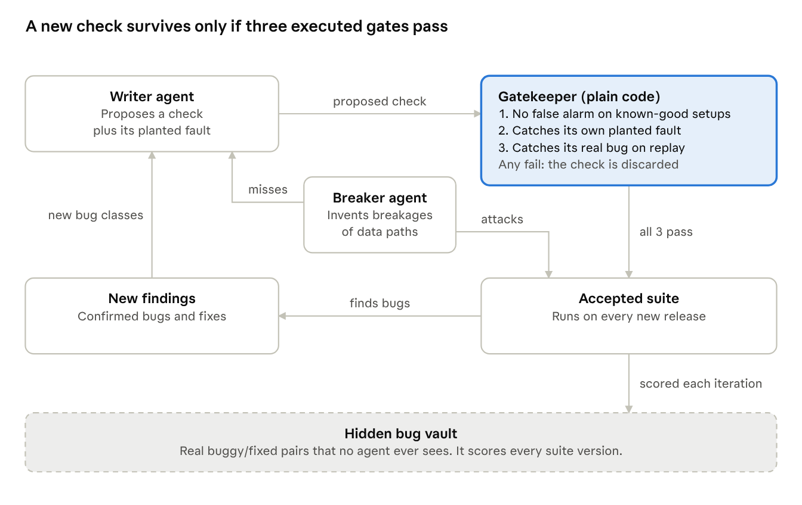
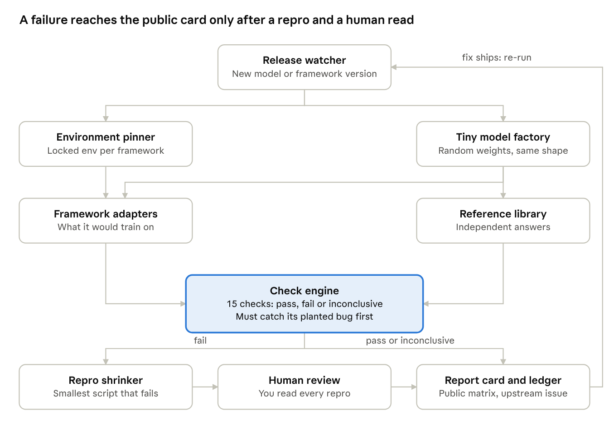
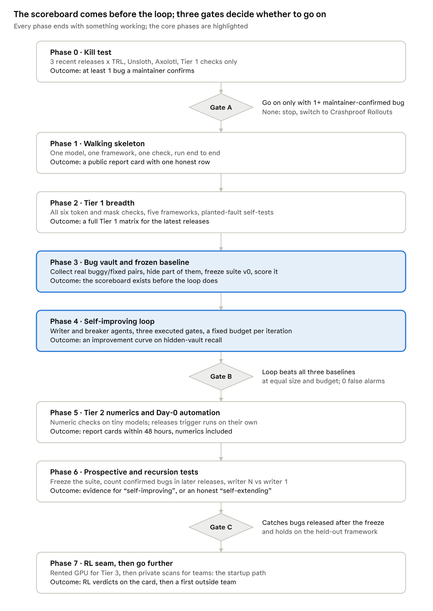

# Parity: Technical Blueprint and Incremental Build Plan

As of Nov 23, 2026 · Live doc: https://claude.ai/artifact/LuCqsapFCxPhWiaD5RJzcu (tab: Overview)

## What we're building

Parity (working name) is a public lab that checks each major open-weight model release against the popular fine-tuning frameworks on day 0. It publishes a correctness report card within 48 hours of the release.

Each check compares what a framework actually feeds into training (tokens, loss mask, loss, gradients, optimizer step, saved checkpoint) against a reference the framework did not produce. A failed check becomes a minimal reproduction script and an upstream issue.

- **Two outputs:** a public report card (model x framework, pass / fail / inconclusive per check) and a ledger of confirmed upstream bugs, each with its repro and fix link.
- **One-line pitch:** the crash-test lab for post-training stacks.
- **What it is not:** not a training platform, not a monitoring dashboard, not an eval leaderboard. It never judges how good a model is, only whether the training plumbing does what it claims.

**What makes it more than a checker:** an agent loop writes new checks. Executed gates decide which ones survive, and the lab has to prove it is improving by answering two questions with evidence (see Evaluation). Both the loop and the evaluation are core deliverables, not extras.

## Why it matters

Silent training bugs are common, slow to find, and pile up around new releases. Amazon checks for them internally, but nobody publishes a neutral check across the frameworks most teams actually use.

- **They're common and expensive.** Across 3 frameworks and 5 models, Amazon's Plumbline found 61 problems, 32 of them silent. On one production platform, diagnosing an escalated training failure averaged 34.7 hours, and 41.9% of cases took more than a day ([Plumbline](https://arxiv.org/abs/2611.13393)).
- **The loss curve hides them.** Plumbline's examples ([paper](https://arxiv.org/pdf/2611.13393)):
  - A loss mask left out the token that ends a reply, so the model was never trained to stop.
  - Loading the MXFP4 gpt-oss-20b checkpoint transposed all 32 experts' down projections. Loss started at 17.08 instead of 1.48, and still fell.
  - bf16 weights updated in place at a learning rate of 5e-6 left 92% of the weights that should change unchanged, while the loss looked normal.
- **They live in the most popular code.** The Transformers Trainer normalized loss wrongly under gradient accumulation, so accumulated runs didn't match full-batch runs. The fix sums the loss and divides by the total non-padding tokens ([Hugging Face, Oct 2024](https://huggingface.co/blog/gradient_accumulation)).
- **Multi-turn RL adds new classes.** Prime Intellect lists several ([May 2026](https://primeintellect.ai/blog/renderers)):
  - A tool-call parser turned a sampled `false` into Python `False`, so the re-rendered tokens no longer matched what was sampled.
  - Some templates strip old `<think>` blocks, which removes sampled tokens from the history.
  - When every turn boundary breaks, a five-turn rollout can cost about 3x the compute.
- **The gap.** Plumbline targets AutoModel, Megatron-SWIFT and Miles, and it isn't released yet. The long tail (TRL, Unsloth, Axolotl, verl, SkyRL) has no public report card per release.

## How it works

Every release goes through the same seven steps, and nothing goes public until a person has read the repro.

1. **Watch.** A new model from a tracked org, or a new framework version, triggers a run.
2. **Pin.** Each framework gets its own locked, isolated environment, so any result can be re-run byte for byte.
3. **Check.** Run the battery:
   - Tier 1 on the release's real tokenizer, on a CPU.
   - Tier 2 on a tiny random-weight copy of the same architecture, on a CPU in fp32.
   - Tier 3 (RL) on a small rented GPU, added later.
4. **Self-test.** Every check must first catch a planted copy of its own bug. If it can't, the result is "inconclusive", never "pass". This is Plumbline's false-negative guard ([paper](https://arxiv.org/pdf/2611.13393)).
5. **Confirm.** A failure is re-run in a clean environment and shrunk to the smallest script that still fails. If it doesn't reproduce, it's dropped.
6. **Report.** You read every repro yourself, then file one polite upstream issue per bug and update the public report card.
7. **Track.** When the fix ships, re-run the check, mark it resolved, and log it in the findings ledger.

## The checks

There are 15 checks in three tiers, and each one compares against a reference the code under test did not produce. Exact checks must match bit for bit. Numeric checks fail only above 4x the measured noise floor, the rule Plumbline calibrated ([paper](https://arxiv.org/pdf/2611.13393)).

**Tier 1: tokens and masks** (real tokenizer, CPU, exact match)

| Check | Compared against | Passes when |
| --- | --- | --- |
| Template parity | The model's own `apply_chat_template` output | Training tokens match exactly |
| Assistant mask | The framework's declared objective (assistant-only or completion-only) | Loss lands on exactly those spans, and the mask isn't empty |
| End of turn | The template's turn-closing token | Every assistant turn's closing token is supervised |
| Special tokens | Tokenizer config and template | One BOS, EOS not masked as padding, no think blocks added or stripped |
| Truncation | The untruncated example | The supervised answer survives, or the drop is reported |
| Multi-turn prefix | The tokens actually sampled | Each next prompt extends the previous token stream exactly |

The mask check matters most. TRL's assistant-only loss needs `` markers in the chat template, and very few models ship them ([TRL #5471](https://github.com/huggingface/trl/issues/5471)). A template without them can return an all-zero mask that trains on nothing while the loss looks fine ([What Broke & Why](https://arxiv.org/pdf/2611.10844)).

**Tier 2: numerics** (tiny random-weight copy of the architecture, CPU, fp32)

| Check | Compared against | Passes when |
| --- | --- | --- |
| Loss parity | Plain PyTorch cross-entropy over the same labels | Equal within rounding |
| Gradient accumulation | One batch of the same total size | Gradients equal within the noise floor |
| Packing isolation | Each packed document run alone | Logits equal within the noise floor |
| Optimizer step | AdamW recomputed in fp64 | Updates equal within rounding; share of stuck weights reported |
| Save and resume | An uninterrupted run | Bitwise equal, step count restored |
| Export round trip | Logits before LoRA merge, conversion or reload | Equal within tolerance, expert layout unchanged |

**Tier 3: the RL seam** (small rented GPU, later phase)

| Check | Compared against | Passes when |
| --- | --- | --- |
| Token in, token out | Tokens the inference engine sampled | The trainer trains on exactly those tokens |
| Logprob parity | Rollout-engine logprobs on the same tokens | Gap under 4x the measured noise floor |
| Serving parity | The training format | A deployed chat endpoint builds identical tokens |

## The self-improving loop

After the hand-written Tier 1 checks exist, the suite starts growing itself. Agents propose new checks, but only executed code decides which ones join the suite.

The writer and breaker never see the hidden vault. The gates decide what joins the suite, and the vault decides whether the suite really got better.

## Evaluation: is it really self-improving?

Parity calls itself self-improving only when it can answer two questions with evidence. That's why the scoreboard (the hidden bug vault and the baselines) gets built before the loop does.

**Question 1: is the suite getting better?**

| Method | What it measures | Watch out for |
| --- | --- | --- |
| Real-bug recall on the hidden vault | Share of real buggy/fixed pairs the suite catches: fails on buggy, passes on fixed | Machine-learning bug sets are messy. One review found only 15.4% of deep-learning faults met its realism conditions, and only 54% reproduced ([Jahangirova et al.](https://arxiv.org/abs/2412.16336)). Re-run every pair several times before it counts |
| Mutation score at equal suite size | Share of planted bugs caught | Mutant detection tracks real fault detection ([Just et al. 2014](https://people.cs.umass.edu/~rjust/publ/mutants_real_faults_fse_2014.pdf)), but only weakly once suite size is controlled ([Papadakis et al. 2018](https://ieeexplore.ieee.org/document/8453121)). A bigger suite looks better for free |
| False-alarm rate | Checks that fire on known-good setups, plus retracted findings | Must stay at 0. Gains bought with false alarms don't count |
| Prospective catches | Confirmed bugs in releases that ship after a freeze date | The strongest evidence: the suite can't have been tuned to bugs that didn't exist yet |

**Question 2: is the loop the reason?**

| Method | What it shows | Borrowed from |
| --- | --- | --- |
| Ablation against baselines | The loop beats a frozen suite, a loop without the breaker, and human-only additions, at the same budget | The Darwin Gödel Machine beat baselines without self-improvement or open-ended exploration ([DGM](https://arxiv.org/abs/2505.22954)) |
| Improvement curve | Vault recall rising each iteration while false alarms stay flat | DGM went from 20.0% to 50.0% on SWE-bench |
| Writer N vs writer 1 | Later writer agents produce more accepted checks per dollar on the same fresh bug classes | DGM's claim that modifying itself also improved its ability to self-modify |
| Transfer | The suite holds up on a framework kept out of the loop | DGM's gains also held on a second benchmark, Polyglot |
| Honest statistics | Several seeds and Wilson confidence intervals. A small vault means wide intervals | Standard practice |

**Self-extending vs self-improving:** if the suite grows but the writer never gets better, call it self-extending. That's still a strong result. Claim only what the evidence supports.

## Main components

There are 13 parts. The adapters and the reference library are the core of the checker, and the last five run the self-improving loop and its evaluation.

| Component | Job | Built from |
| --- | --- | --- |
| Release watcher | Spots new model and framework releases on a watchlist | Hugging Face Hub API, GitHub releases, a scheduled job |
| Environment pinner | One locked, isolated environment per framework version | uv lockfiles, Docker |
| Framework adapters | One small shim per framework that returns exactly what it would train on (tokens, labels, masks, position ids) and can run a few steps | TRL, Unsloth, Axolotl, verl, SkyRL |
| Reference library | The independent answers: official template, plain PyTorch loss, fp64 AdamW, unpacked forward pass | transformers, PyTorch |
| Tiny model factory | A random-weight, few-layer copy of a new architecture, built from its config | transformers `from_config` |
| Check engine | Runs checks, applies the pass rules, runs the self-tests | A pytest-style runner |
| Repro shrinker | Cuts a failure down to the smallest script that still fails | Your own code |
| Report card and ledger | The public matrix and the history of findings | JSON files, a static site |
| Writer agent | Reads issues, changelogs and template diffs; proposes a new check plus its planted fault | An LLM API with tool access to the repo |
| Breaker agent | Invents new ways to break a framework's data path; every miss is a blind spot sent to the writer | A separate LLM agent, never the writer |
| Gatekeeper | Runs the three executed gates on every proposed check: no false alarm, catches its planted fault, catches its real bug on replay | Plain code, no LLM |
| Bug vault | Real bugs as reproducible buggy/fixed version pairs; a hidden part no agent ever sees | Confirmed findings plus fixed upstream issues |
| Evaluation harness | Scores every suite version and baseline on the vault; draws the improvement curve | Your own code, Wilson intervals |

## Rough architecture

Passes go straight to the card. A failure is shrunk to a repro and read by you before anything is posted, and every shipped fix triggers a re-run.

## Open-source tools to reuse

Stand on shoulders of giants: reuse every reference and check idea that already exists, and build only the cross-framework harness and the report card.

| Tool | What we take from it |
| --- | --- |
| Hugging Face transformers | `apply_chat_template` and `return_assistant_tokens_mask`: the reference tokens and masks |
| [TRL training templates](https://github.com/huggingface/trl/issues/5471) | Templates with `` markers for 15 language-model families, a second reference to cross-check |
| [Plumbline](https://arxiv.org/abs/2611.13393) (open source planned) | Check designs, the 4x noise-floor rule, the planted-fault guard. Adopt it when it ships, don't compete |
| [TrainCheck](https://www.usenix.org/conference/osdi25/presentation/jiang) (OSDI '25, open source) | Ideas for training invariants in Tier 2 |
| [TrainSight](https://github.com/Aravind0403/trainsight-preflight), [dropoutt](https://github.com/ckproduces/dropoutt-cli), [trainproof](https://github.com/Mormolykos/trainproof) | Data-level lint ideas. Don't rebuild what they already cover |
| hf-internal-testing tiny models | Ready-made tiny random-weight copies of older architectures |
| uv, Docker | Locked, reproducible environments per framework version |
| GitHub Actions | Scheduled runs and the public report card build |
| TRL, Unsloth, Axolotl, verl, SkyRL | The frameworks under test. Their own test suites show what they already guard |

## Roadmap

Each phase ships something you can show. Gate A is the kill test. Gate B proves the loop beats its baselines. Gate C is where you earn the word "self-improving".

| Phase | Scope | Outcome |
| --- | --- | --- |
| 0 · Kill test | 3 recent releases x TRL, Unsloth, Axolotl, Tier 1 checks only | At least 1 bug a maintainer confirms |
| Gate A | Go on only with 1+ maintainer-confirmed bug | None: stop, switch to Crashproof Rollouts |
| 1 · Walking skeleton | One model, one framework, one check, run end to end | A public report card with one honest row |
| 2 · Tier 1 breadth | All six token and mask checks, five frameworks, planted-fault self-tests | A full Tier 1 matrix for the latest releases |
| 3 · Bug vault and frozen baseline | Collect real buggy/fixed pairs, hide part of them, freeze suite v0, score it | The scoreboard exists before the loop does |
| 4 · Self-improving loop | Writer and breaker agents, three executed gates, a fixed budget per iteration | An improvement curve on hidden-vault recall |
| Gate B | Loop beats all three baselines at equal size and budget; 0 false alarms | |
| 5 · Tier 2 numerics and Day-0 automation | Numeric checks on tiny models; releases trigger runs on their own | Report cards within 48 hours, numerics included |
| 6 · Prospective and recursion tests | Freeze the suite, count confirmed bugs in later releases, writer N vs writer 1 | Evidence for "self-improving", or an honest "self-extending" |
| Gate C | Catches bugs released after the freeze and holds on the held-out framework | |
| 7 · RL seam, then go further | Rented GPU for Tier 3, then private scans for teams: the startup path | RL verdicts on the card, then a first outside team |

## How we know it's working

The north star is bugs that maintainers confirm. Everything else measures whether you can trust the lab.

| Metric | Target |
| --- | --- |
| Maintainer-confirmed upstream bugs | At least 1 in the kill test, then a steady stream |
| Retracted findings (turned out not to be bugs) | 0. Any retraction triggers a review of that check |
| Time from public release to report card | Under 48 hours |
| Checks that catch their own planted bug | 100%. A check that can't is off until fixed |
| Coverage | Models x frameworks x checks run, shown on the report card |
| Hidden-vault recall, at equal suite size | Rises with each loop iteration |
| Loop vs baselines | Beats the frozen, no-breaker and human-only baselines at equal budget |
| Writer N vs writer 1 | More accepted checks per dollar on the same fresh bug classes |
| Transfer | Recall holds on the framework kept out of the loop |

**Kill criteria:**

- **After the kill test:** zero confirmed bugs across 3 recent releases x 3 frameworks means you stop and switch to Crashproof Rollouts.
- **After the loop:** if it can't beat the human-only baseline at equal budget, keep the hand-written suite and publish the negative result. That's still a finding.
- **Later:** if the frameworks ship their own version of every check, the lab has done its job. Shift to contributing those checks upstream.

## Risks and how we handle them

The biggest risk isn't finding nothing. It's crying wolf. Every rule below exists to keep the retraction count at zero.

| Risk | What we do |
| --- | --- |
| "It's not a bug, it's a choice" (e.g. masking the system prompt on purpose) | Flag only divergence from the framework's own declared setting or the official template. Label it "difference" or "bug", never just "fail" |
| The reference itself is wrong (the template in the tokenizer config disagrees with the model card or official renderer) | That's a model-release finding. Report it to the model team and mark both sides |
| Frameworks already test this, or fix fast | Good: the card shows green. The value shifts to day-0 speed and to new model families |
| Plumbline goes open source | Use its checks as a library. Parity's value is public, long-tail coverage and the report card |
| Maintainer fatigue or a bad first impression | One bug per issue, a minimal repro, a human read before posting. Never auto-file |
| Tiny models miss bugs that only appear at full size or in GPU kernels | State the scope on the card. Tier 3 covers the GPU seam later |
| No early access to releases | 48 hours after the public release is fine. Early access is a relationship you earn later |
| Agents game the gates or overfit to bugs they invented | Writer and breaker are separate agents, every gate is executed code, and the hidden vault is never shown to any agent |
| The vault is too small, so the results are noise | Several seeds, Wilson intervals, and prospective catches as the tiebreaker |
| Vault bugs don't reproduce | Re-run each buggy/fixed pair several times, and drop any flaky pair |

## Budget and hardware

Tiers 1 and 2 cost about $0, because they run on CPU: your laptop plus scheduled GitHub Actions runs. Only Tier 3 needs a rented GPU, in short sessions.

| Tier | Hardware | Cost |
| --- | --- | --- |
| 1: tokens and masks | Laptop CPU; downloads only tokenizers and configs, never full weights | ~$0 |
| 2: numerics | Laptop CPU; tiny random-weight models in fp32 | ~$0 |
| 3: RL seam | One rented GPU per session (RTX 4090 from $0.34/hr, A100 80GB from $1.19/hr on RunPod Community Cloud, Sept 2026 [prices](https://tech-insider.org/runpod-vs-lambda-vs-vast-ai-2026/)) | Rough estimate: under $100 for the phase |
| Self-improving loop | LLM API calls for the writer and breaker agents; all gates still run on CPU | A fixed dollar cap per iteration, which also keeps the equal-budget comparison fair |

The real cost is time. Each new framework adapter means reading that framework's data path closely, which is also the main thing you learn.

## Career payoff

The artifact that gets you hired is the findings ledger: confirmed bugs, merged fixes and maintainer replies that anyone can click and verify.

**The resume line:** "Built Parity, an open correctness lab for post-training stacks. Found N silent bugs across TRL, Unsloth, Axolotl, verl and SkyRL on day-0 model releases; M fixed upstream."

**What it proves for applied AI and post-training infra roles:**

- **Post-training workflows:** you know exactly what SFT and RL feed into the loss, token by token.
- **Debugging across the stack:** tokenizer, template, collator, loss, optimizer, checkpoint, inference engine.
- **Reliability judgment:** objective pass rules, noise floors, planted-fault self-tests, zero retractions.
- **Automated research loops:** an agent loop that improves the suite, judged by executed gates and a held-out evaluation, with honest baselines.
- **Build vs adopt:** you reused Plumbline, TrainCheck and the framework test suites instead of reinventing them.
- **Working with researchers and maintainers:** clean repros and fixes that get merged.

**What you learn along the way:** tokenizers and chat templates, loss masking, bf16 vs fp32 numerics, optimizer internals, checkpoint formats (safetensors, MXFP4), mixture-of-experts layouts, and the rollout/trainer seam in RL.

Interfaces, schemas, pass rules, the Phase 0 runbook, and the loop, vault and evaluation protocol: see `02-detailed-blueprint.md`.
